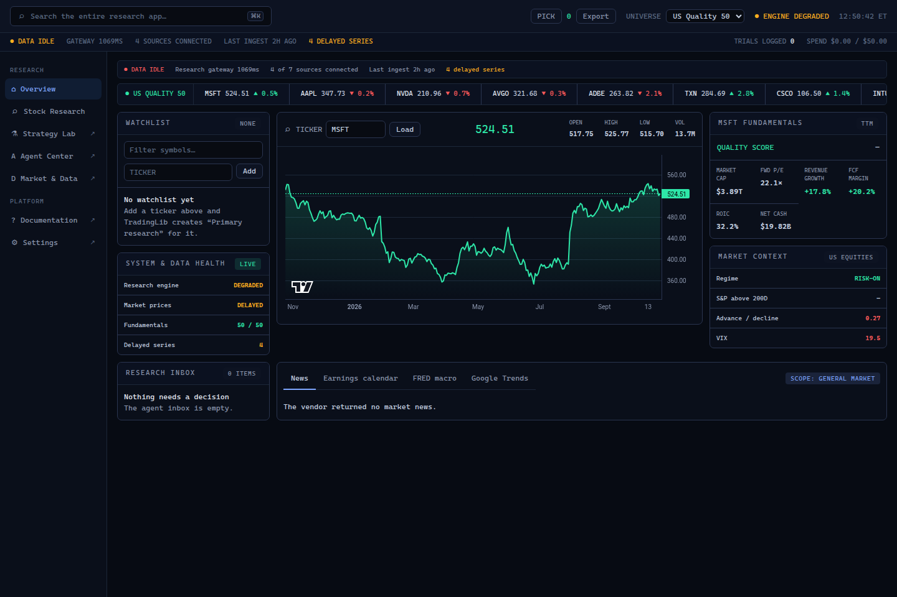
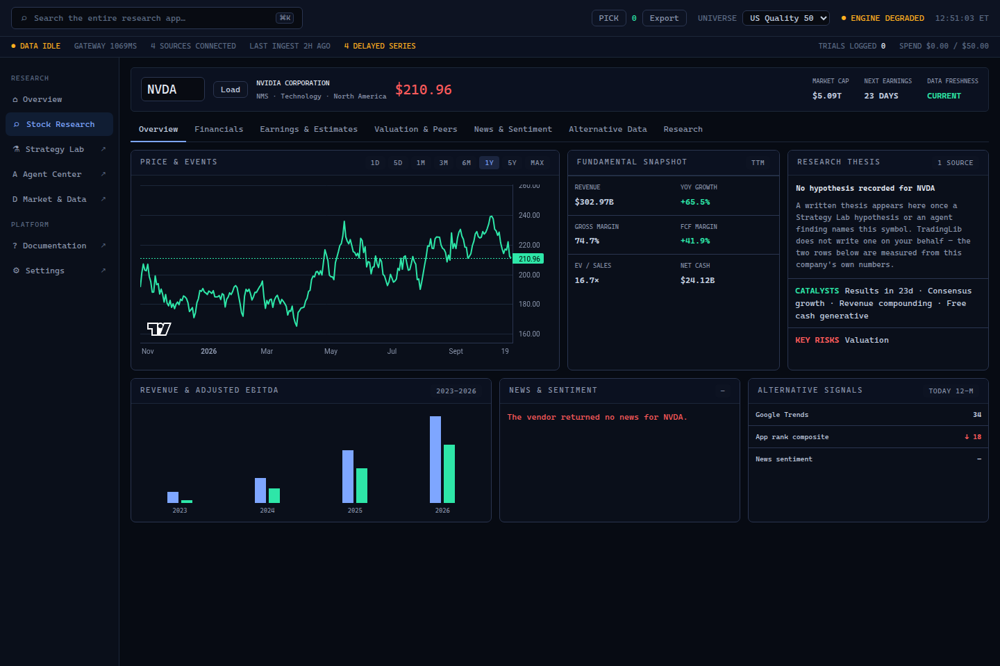

# TradingLib

[](https://github.com/Donidutch/TradingLib/actions/workflows/ci.yml)


A trading research workstation where language-model agents propose and
deterministic code decides. TradingLib is a Python library, a FastAPI service
with a WebSocket feed, and a browser research console. Agents built on the
Claude Agent SDK generate and test strategy hypotheses through in-process MCP
tools; the research engines score them; every pipeline stops at a human
approval step that no pipeline can remove; and agents never place live orders.

> Research software, not investment advice. Trading is paper-only by default;
> live brokers refuse to start unless `TRADINGLIB_ALLOW_LIVE_TRADING` is set.

## Highlights

- **Agent pipelines as versioned DAGs.** Each stage has an assigned agent, an
  optional model override, a scope, an objective, input and output contracts
  and a handoff condition. Every run records the pipeline version it executed,
  and an approved pipeline is locked against edits.
- **A human gate that cannot be automated away.** The approval stage is
  immutable inside every pipeline: it cannot be removed, disabled or pointed
  at a model, because it is the reason automation stops.
- **Claude Agent SDK with in-process MCP tools** (`tradinglib/agents/providers.py`),
  plus approvals, audit trail, findings, inbox and knowledge store, with
  per-run, daily and monthly spend budgets.
- **Research engines:** backtests, walk-forward analysis, parameter sweeps with
  a stability check, Monte Carlo, deflated Sharpe, a capacity estimate from
  traded volume, and correlation against the paper book.
- **Data layer:** providers, connectors, caching and quality checks. Runs
  keyless by default (yfinance, SEC EDGAR, FRED CSV, Google Trends); services
  without credentials report "not configured" instead of substituting data.
- **Brokers:** a built-in paper broker, plus Alpaca and IBKR adapters behind an
  explicit live-trading opt-in.

## Quickstart

Requires Python 3.14 and [uv](https://docs.astral.sh/uv/).

```bash
git clone https://github.com/Donidutch/TradingLib.git
cd TradingLib
uv sync --extra test
uv run pytest -q                 # 626 passed, 10 skipped (live-network tests are opt-in)
uv run python -m tradinglib.api  # console at http://127.0.0.1:8200
```

The service serves the console from `ui/` at `/`, the JSON API under `/api`
and a WebSocket at `/ws`. The React console is served at `/app` once it is
built (see below).

LLM agent stages run through the Claude Agent SDK, which uses either an
Anthropic API key or a locally authenticated Claude Code CLI.

### Why `python -m tradinglib.api` and not bare `uvicorn`

The entry point pins uvicorn to the asyncio event loop. Under uvloop, the
subprocesses that agent stages start are forked from a server holding
`curl_cffi` handles (yfinance's HTTP transport), and the child crashes before
it can exec. If you run uvicorn yourself, pass the loop explicitly:

```bash
uv run uvicorn tradinglib.api.app:create_app --factory --port 8200 --loop asyncio
```

## React console (`web/`)

The console is being ported page by page to React + TypeScript
([`docs/UI_PORT.md`](docs/UI_PORT.md)). The shell, Overview, Stock Research,
Market & Data, Settings, Docs and the Strategy Lab's hypotheses and
experiments are done and run beside the vanilla console; pages not yet ported
link to it.




Requires Node 22.12 or newer.

```bash
cd web
npm ci
npm run build      # the API then serves web/dist at http://127.0.0.1:8200/app
npm run dev        # or a dev server on :5173 that proxies /api and /ws to :8200
npm run lint && npm run typecheck && npm test
npm run check:api  # validate every response schema against a running API
npm run check:api:writes  # writes and live frames, on an API of its own over a temporary copy of data/
```

`uv run python tools/compare_consoles.py` loads each ported page in both
consoles with headless Chromium and compares every figure on it.

Stack: Vite, React 19, strict TypeScript, TanStack Router and Query, Zod (every
response is validated, and a mismatch is an error rather than an empty panel),
Tailwind v4 restricted to the design tokens in `web/src/ui/tokens.css`,
lightweight-charts, Vitest with Testing Library.

## Configuration

Settings come from environment variables and an optional `tradinglib.toml` in
the repository root; environment variables win. Copy
`tradinglib.toml.example` to start. Every key is documented in
`tradinglib/config.py`.

## Docker

```bash
docker compose up --build        # http://127.0.0.1:8200 and /app
```

The `Dockerfile` has three stages: Node builds the React console, `uv`
installs the locked Python environment, and the runtime image gets only the
virtual environment and the two consoles (no Node, no `uv`, no build cache).
The server runs as an unprivileged user; only `/app/data` is writable, and
Compose keeps it in a named volume. API keys go in a local `.env` file as
`TRADINGLIB_*` variables (see Configuration); `.dockerignore` keeps `.env`,
`tradinglib.toml` and `data/` out of the image. The API has no
authentication, so the port is published on `127.0.0.1` only.

LLM agent stages need `ANTHROPIC_API_KEY` (or `TRADINGLIB_ANTHROPIC_API_KEY`) inside a container,
since there is no logged-in Claude Code CLI there.

CI builds the image, starts it and checks the health endpoint, both consoles
and that the process is not running as root.

## Layout

```
tradinglib/
  agents/     pipelines, runner, providers (Claude Agent SDK), approvals, audit, knowledge
  research/   backtest, analyses, validation, evaluation, capacity, hypotheses
  data/       providers, ingest, cache, quality, universes
  trade/      paper broker, portfolio, Alpaca and IBKR adapters
  api/        FastAPI app, routes, WebSocket
ui/           browser research console (vanilla JS), served at /
web/          React + TypeScript console, served at /app
tests/        pytest suite
docs/         build specification, UI coverage matrix, roadmap
```

## Tests

```bash
uv run pytest -q
TRADINGLIB_NETWORK_TESTS=1 uv run pytest -q   # also run the live vendor tests
```

CI runs the suite on every push and pull request.

## Documents

| File | Role |
|---|---|
| [`docs/SPEC.md`](docs/SPEC.md) | Build specification |
| [`docs/COVERAGE.md`](docs/COVERAGE.md) | UI element to endpoint to backend matrix |
| [`docs/TODO.md`](docs/TODO.md) | Remaining work |

## License

[MIT](LICENSE)
